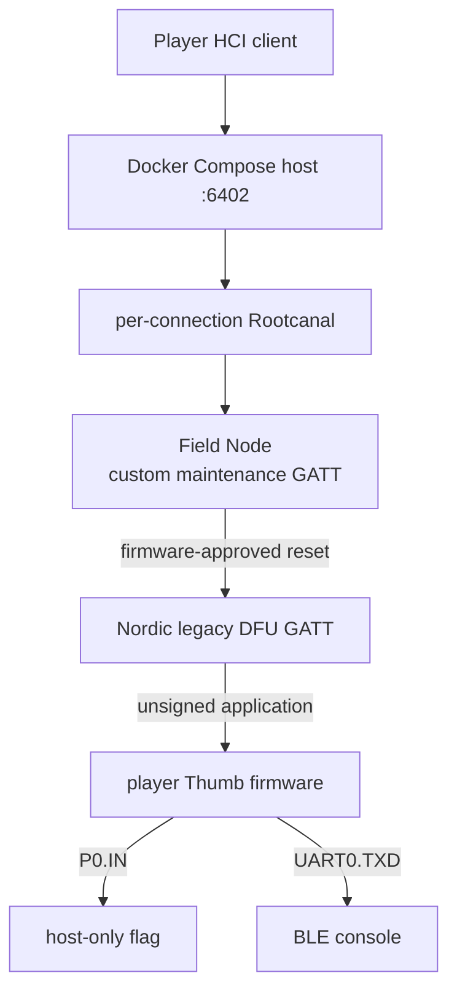

# Nordic legacy DFU CTF target

這題的唯一安全問題是 Nordic **legacy BLE DFU 不驗證 application firmware signature**。
參賽者最後可刷入自己的 Thumb firmware，從 GPIO 讀 flag，再用 UART 輸出；沒有 parser bug、
memory corruption 或 Web 題。

## 參賽者流程

裝置一開始是普通的 `HITCON Field Node`，只廣播 vendor maintenance service，不會出現
Nordic DFU UUID。題目附件提供 `maintenance_application.bin`：參賽者先 reverse 這個正常
application，找出它接受的 maintenance-mode request，對 control characteristic 寫入後，裝置會
reset。

重新連線後才會出現 Nordic legacy DFU service (`1530`)。此時無簽章的 legacy DFU 才是題目的
漏洞：刷入自己的 application、讀 `P0.IN`，並經 `UART0.TXD` 取回 flag。



每一條 player HCI/H4 TCP connection 都有自己的一組 Rootcanal、Qiling target 與 flag instance；
player 斷線後，這組 instance 會一起結束。

## 實作邊界

- `maintenance_application.elf` 是真正編譯的 nRF51 Thumb firmware，載入 Qiling 後由其
  `maintenance_command()` 驗證 GATT request，並寫入 `POWER.GPREGRET = 0xb1`。
- Bumble 提供 normal application 的 custom GATT service 和 HCI controller；它只把 write 交給
  firmware handler，不保存 boot command。
- 成功後 Bumble 關閉 normal target controller、以相同 BLE address 開新的 controller，才啟動
  Qiling 裡官方 SDK 11 legacy bootloader ELF。
- DFU GATT write 會進入編譯好的 Nordic code。DFU callback、CRC、flash staging 與 dual-bank
  activation 都不是 Python state machine。

這不是完整的 S130 radio emulation：Rootcanal/Bumble 管 HCI/ATT，狹窄的 Qiling shim 提供
bootloader 所需的 BLE event、notification 與 flash-completion ABI。

## 題目設定

- Target：nRF51422、nRF5 SDK 11、S130 2.0.0、dual-bank legacy DFU。
- application base：`0x1b000`；bootloader base：`0x3c000`。
- legacy DFU 只接受 application image，最大 `0x10800` bytes、4-byte aligned。
- Flag 不在 guest flash、SRAM 或 filesystem；payload 必須讀取 `P0.IN` (`0x50000510`)。
- payload 可寫 `UART0.TXD` (`0x4000251c`)；activate/reset 後重新連線讀 console characteristic。

## Docker Compose

```bash
cp flag.example flag.txt
# 編輯 flag.txt
FLAG_FILE=./flag.txt docker compose up --build
```

Host 對外只開 `6402/tcp`，這是 HCI/H4 TCP，不是 DFU-over-TCP。用 `HCI_PORT=7402` 可改 port。

Compose image 內含給參賽者的 raw firmware：

```bash
docker compose cp host:/app/handout/maintenance_application.bin ./maintenance_application.bin
```

請只把這個 `.bin` 放進題目附件；`firmware/maintenance_application.c` 是出題端 build source。

## 本機建置

```bash
sudo apt-get install gcc-arm-none-eabi libnewlib-arm-none-eabi
./scripts/fetch_nrf51_sdk11.sh
./scripts/build_nrf51_sdk11_legacy_dfu.sh
./scripts/build_maintenance_application.sh
python3 -m pip install -e '.[full]'
```

手動啟動時，先開 Rootcanal：

```bash
python3 -m rootcanal \
  --hci_port=6402 --test_port=6401 --link_port=6403 --link_ble_port=6404 \
  --enable_log_color=false
```

再開完整兩階段 target：

```bash
hitcon-legacy-dfu \
  --secret-file /run/secrets/team-01.flag \
  --hci-transport tcp-client:127.0.0.1:6402 \
  --reference-bootloader-elf artifacts/nrf51_sdk11_legacy_dfu/nrf51422_xxac.elf \
  --maintenance-firmware-elf artifacts/maintenance_application/maintenance_application.elf
```

`--maintenance-firmware-elf` 不帶時保留直接進 DFU 的開發模式；Compose session host 固定使用
兩階段模式。

## 測試

```bash
PYTHONPATH=src python3 -m unittest discover -s tests -v
```

完整環境會驗證：normal service 不可發現 DFU、reversed maintenance request 會造成 reset、DFU
才在重連後出現，以及 Bumble/Rootcanal/Qiling 的完整 DFU→GPIO→console 路徑。
