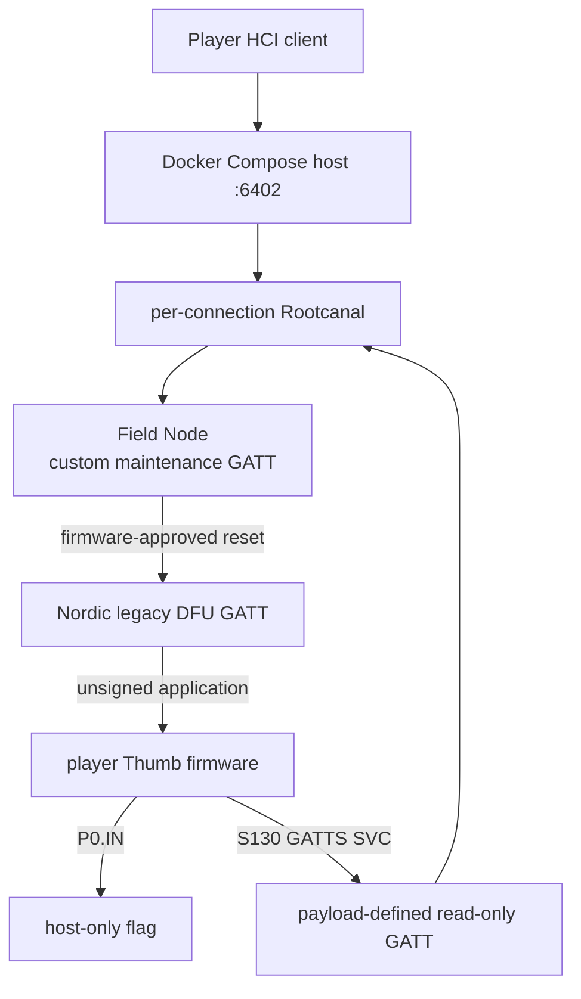

# Nordic legacy DFU CTF target

這題的唯一安全問題是 Nordic **legacy BLE DFU 不驗證 application firmware signature**。
參賽者最後可刷入自己的 Thumb firmware，從 GPIO 讀 flag，再由該 firmware 自己建立唯讀 GATT
service 取回；沒有 parser bug、memory corruption、UART console 或 Web 題。

## 參賽者流程

裝置一開始是普通的 `HITCON Field Node`，只廣播 vendor maintenance service，不會出現
Nordic DFU UUID。題目附件只提供完整的 `board_flash.bin`；參賽者從 `0x1b000` 的正常
application 區域進行 reverse，找出它接受的 maintenance-mode request，對 control
characteristic 寫入後，裝置會 reset。

重新連線後才會出現 Nordic legacy DFU service (`1530`)。此時無簽章的 legacy DFU 才是題目的
漏洞：刷入自己的 application、讀 `P0.IN`，並透過 S130 ABI 註冊自己的唯讀 GATT
characteristic 取回 flag。



每一條 player HCI/H4 TCP connection 都有自己的一組 Rootcanal、Qiling target 與 flag instance；
player 斷線後，這組 instance 會一起結束。

## 實作邊界

- `board_flash.bin` 內從 `0x1b000` 開始的 application 是真正編譯的 nRF51 Thumb firmware，
  載入 Qiling 後由其 `maintenance_command()` 驗證 GATT request，並寫入
  `POWER.GPREGRET = 0xb1`。
- maintenance application 透過真正的 S130 ABI 呼叫 `sd_ble_uuid_vs_add()`、
  `sd_ble_gatts_service_add()` 與 `sd_ble_gatts_characteristic_add()` 建立動畫 GATT service；
  `BLE_GATTS_EVT_RW_AUTHORIZE_REQUEST` 的處理與 `sd_ble_gatts_rw_authorize_reply()` 也都在 Thumb
  firmware。UUID、frame table、timeline 與 cursor 同樣在該 image。
- runtime 使用同一份 256 KiB `board_flash.bin`；application 位於 `0x1b000`、官方 SDK 11 legacy
  bootloader 位於 `0x3c000`。成功後 Bumble 模擬 reset，以相同 BLE address 依 GPREGRET 選擇
  bootloader phase，而不是換用另一包 firmware artifact。
- DFU GATT write 會進入編譯好的 Nordic code。DFU callback、CRC、flash staging 與 dual-bank
  activation 都不是 Python state machine。
- activate/reset 會銷毀 bootloader controller 與整張 DFU attribute table，再用相同 BLE address
  建立 application controller。新 GATT database 只來自 uploaded firmware 執行的 S130 service／
  characteristic registration；host 沒有預製 output service，也不擷取 UART。

這不是完整的 S130 radio emulation：Rootcanal/Bumble 管 HCI/ATT，狹窄的 Qiling shim 把 firmware
發出的通用 S130 GATTS 註冊映射成 attribute table，並提供 normal application／bootloader 所需的
BLE event、authorization reply、notification 與 flash-completion ABI。

## Application 的 ASCII 動畫

正常 application 另有一個獨立的 128-bit GATT service，只有一個 READ characteristic：

- Service UUID：`5a1c1001-7c5d-4c8d-942c-a786c1d58b6d`
- Frame characteristic UUID：`5a1c1002-7c5d-4c8d-942c-a786c1d58b6d`

每次對 frame **value handle** 發出新的 ATT Read Request，就開始讀下一幀；Read Blob 的續讀、
重試（含 offset 0）都維持同一幀，不再推進。54 幀循環播放，每幀為固定 17 × 7 的 ASCII，
含換行共 125 bytes，不含標題、幀號或 NUL。部分幀刻意重複以停留在關鍵動作。

上述 UUID base、10 個 unique poses、54-entry timeline、cursor、service initialization 與 read
event handler 都編進 `board_flash.bin` 的 application 區域。Python server/runtime 不使用 Inmu King UUID、
frame list 或 next-frame counter；公開的 Python UUID 常數只供 client、文件與測試使用。transport
只攔截通用 S130 SVC、合成 `ble_evt_t`，並把 firmware 的 authorize reply 交回 Bumble。由於沒有
執行 proprietary S130，Read Blob 的 attribute snapshot 留在這層 SoftDevice adapter，避免分段讀到
不同 frame。

請在**同一條 BLE connection** 上連續讀取；重新連線會從第一幀開始。預設 MTU 23 會用
long read 組合完整一幀；UUID 是 128-bit 與讀取長度無關。Read By Type／Read Multiple 只查看
目前快照、不換幀；尤其 read-by-UUID 可能被截斷，請先 discovery，再用 value handle 讀取。
不支援 WRITE、NOTIFY 或 INDICATE，進入 DFU 後也不再提供此 service。

Legacy advertising 的 31-byte 空間放不下兩個 128-bit UUID，因此只廣播 maintenance UUID，
並標為 incomplete list；動畫 service 可在連線後用 GATT discovery 找到。

啟動更新後的 Compose host（`docker compose up --build`），可用原本的預覽腳本直接從 GATT
逐幀讀回並播放，不需先進 maintenance boot mode：

```bash
python3 -m pip install -e '.[transport]'
python3 scripts/preview_inmu_king_art.py \
  --hci-transport tcp-client:127.0.0.1:6402 --loops 0
```

加 `--step` 可按 Enter 讀下一幀、輸入 `q` 結束；不帶 `--hci-transport` 仍是離線預覽。
GATT 預覽預設維持 MTU 23，用實際 long read 取得資料。若透過 BlueZ HCI adapter 使用
`gatttool`，請在 interactive connection 裡反覆 `char-read-hnd <value-handle>`；它顯示的是
hex bytes，需解碼 ASCII 才會看到圖。Compose 的 `6402/tcp` 是 HCI/H4，不能直接當 BLE address
交給 `gatttool -b`。

## 題目設定

- Target：nRF51422、nRF5 SDK 11、S130 2.0.0、dual-bank legacy DFU。
- application base：`0x1b000`；bootloader base：`0x3c000`。
- legacy DFU 只接受 application image，最大 `0x10800` bytes、4-byte aligned。
- Flag 不在 guest flash、SRAM 或 filesystem；payload 必須讀取 `P0.IN` (`0x50000510`)。
- uploaded payload 可用的輸出路徑只有 S130 GATT：目前 shim 支援
  `sd_ble_uuid_vs_add` (`svc 0x63`)、`sd_ble_gatts_service_add` (`svc 0xa0`) 與
  `sd_ble_gatts_characteristic_add` (`svc 0xa2`)。輸出 characteristic 必須是 READ-only；
  activate/reset 後由同一條 Rootcanal HCI session 重新連線並 discovery/read。

## Docker Compose

```bash
cp flag.example flag.txt
# 編輯 flag.txt
FLAG_FILE=./flag.txt docker compose up --build
```

Host 對外只開 `6402/tcp`，這是 HCI/H4 TCP，不是 DFU-over-TCP。用 `HCI_PORT=7402` 可改 port。

Compose image 只保留執行 target 所需的完整 `/app/artifacts/board_runtime/board_flash.bin` 與
`runtime_symbols.json`，不再另放一份 application firmware。

正式 attachment 同樣只提供單一完整 board flash，以及可在本機啟動相同 Rootcanal + Qiling
target 的 Docker Compose lab、player-safe Python harness、narrow runtime metadata、固定的 local
test flag 與一支無害 GATT probe。`board_flash.bin` 應以 image base `0` 載入；application 從
`0x1b000` 開始，bootloader 從 `0x3c000` 開始，需要時可自行依此切割。
`firmware/maintenance_application.c` 仍只存在出題端 source／service bundle，不會放進 player
attachment；已知 maintenance command 與範例 exploit payload 也不會被打包。

## 本機建置

```bash
sudo apt-get install gcc-arm-none-eabi libnewlib-arm-none-eabi
./scripts/fetch_nrf51_sdk11.sh
./scripts/build_nrf51_sdk11_legacy_dfu.sh
./scripts/build_maintenance_application.sh
python3 scripts/build_board_runtime.py \
  --maintenance-bin artifacts/maintenance_application/maintenance_application.bin \
  --maintenance-elf artifacts/maintenance_application/maintenance_application.emulator.elf \
  --bootloader-bin artifacts/nrf51_sdk11_legacy_dfu/nrf51422_xxac_flash.bin \
  --bootloader-elf artifacts/nrf51_sdk11_legacy_dfu/nrf51422_xxac.emulator.elf \
  --output-dir artifacts/board_runtime
python3 -m pip install -e '.[full]'
```

手動啟動時，先開 Rootcanal：

```bash
python3 -m rootcanal \
  --hci_port=6402 --test_port=6401 --link_port=6403 --link_ble_port=6404 \
  --enable_log_color=false
```

再開完整兩階段 target：

```bash
yaju-os \
  --secret-file /run/secrets/team-01.flag \
  --hci-transport tcp-client:127.0.0.1:6402 \
  --board-runtime artifacts/board_runtime
```

CLI、Compose 與 release attachment 都固定使用同一包 `board_runtime` 走完整兩階段模式；不再提供
per-phase ELF 或 Python DFU model 的 production fallback。

## 測試

```bash
PYTHONPATH=src python3 -m unittest discover -s tests -v
```

完整環境會驗證：normal service 不可發現 DFU、reversed maintenance request 會造成 reset、DFU
才在重連後出現，以及 Bumble/Rootcanal/Qiling 的完整
DFU→GPIO→payload-defined GATT 路徑；測試也確認 application reset 後 DFU service 已消失。動畫測試涵蓋
MTU 23 的完整循環、不同 MTU／分段邊界、offset 重試、唯讀限制與重連歸零，逐 byte 比對
firmware 的 S130 registration／read-authorize event 和離線 preview，並驗證 DFU 階段不再有動畫
service。

## CI 與發布包

GitHub Actions 會使用專案的 Dockerfile 建置正式映像、執行完整測試，接著產生一個 workflow
artifact，其中固定包含：

- `yaju-os-attachment.zip`：給參賽者的 Rootcanal/Qiling emulator harness、唯一的
  firmware blob `board_flash.bin`、`runtime_symbols.json`、Docker
  Compose local lab、公開 local test flag、GATT probe、build metadata 與 SHA-256 manifest；不含
  firmware source、organizer tests、已知 maintenance command 或 solution payload generator。
- `yaju-os-service.zip`：可直接部署的 Docker Compose build context、部署說明與
  SHA-256 manifest；`src/` 只含 production board runtime，不含 Python DFU model、client、payload
  helper 或離線動畫資料；只含 `flag.example`，不含真實 flag、SDK、cache、artifacts 或 tests。
- `SHA256SUMS`：上述兩個 ZIP 自身的 checksum。

CI 會解開兩個 ZIP：service bundle 會執行 `docker compose config` 並從解開後的內容重新 build；
player attachment 也會從解開後的內容 build、啟動 session host，再由另一個 container 經過公開
HCI/H4 port 做一次真實 BLE GATT read；最後用不會打包的 organizer smoke client 完整走過
maintenance reset、unsigned DFU、Thumb GPIO/S130 payload 與自建 characteristic flag read，確認
從頭到尾唯一的 client I/O 都走公開的 Rootcanal HCI socket。每次 push、pull request 與手動 dispatch
都會執行；成功後可在該 workflow run 的
Artifacts 區下載。

推送 `v*` tag 時，CI 還會在 GitHub Releases 建立對應版本，並把上述兩個 ZIP 與
`SHA256SUMS` 發布為 Release assets。重新執行同一個 tag 的 workflow 時會覆寫既有 assets，
不會建立重複的 Release。

本機已建好 firmware 時，也可以產生相同格式：

```bash
SOURCE_DATE_EPOCH="$(git show -s --format=%ct HEAD)" \
python3 scripts/package_release.py \
  --board-flash artifacts/board_runtime/board_flash.bin \
  --runtime-symbols artifacts/board_runtime/runtime_symbols.json \
  --revision "$(git rev-parse HEAD)"
```
