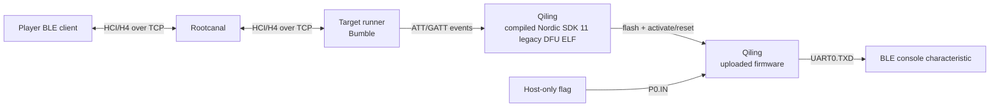

# Nordic legacy DFU CTF target

這題只利用 Nordic **legacy BLE DFU 沒有驗證 firmware signature** 這件事。
參賽者刷入自己的 Thumb firmware，從題目板的 GPIO 讀取 flag，再透過 UART 輸出。
沒有額外疊 parser bug、memory corruption 或 Web 題。

## 架構



Rootcanal 的 port 是 HCI/H4 TCP，不是 DFU-over-TCP。Player 與 target 都要各自接一條
HCI connection 到同一個 Rootcanal instance。

## 題目設定

- Target：nRF51422、nRF5 SDK 11、S130 2.0.0、dual-bank legacy DFU。
- 只接受 application image；image 必須 4-byte aligned，最大 `0x10800` bytes。
- Application base 是 `0x1b000`，bootloader base 是 `0x3c000`。
- Flag 不在 guest flash、SRAM 或 filesystem；firmware 必須讀取 `P0.IN`
  (`0x50000510`) 才能取得它。
- Firmware 可寫 `UART0.TXD` (`0x4000251c`)；activate/reset 後重新連線讀 console
  characteristic 即可看到輸出。

## 建置與啟動

首次需要編譯官方 Nordic bootloader：

```bash
sudo apt-get install gcc-arm-none-eabi libnewlib-arm-none-eabi
./scripts/fetch_nrf51_sdk11.sh
./scripts/build_nrf51_sdk11_legacy_dfu.sh
python3 -m pip install -e '.[full]'
```

啟動 Rootcanal：

```bash
python3 -m rootcanal \
  --hci_port=6402 --test_port=6401 --link_port=6403 --link_ble_port=6404 \
  --enable_log_color=false
```

再啟動 target。建議使用 direct-ELF mode：

```bash
hitcon-legacy-dfu \
  --secret-file /run/secrets/team-01.flag \
  --hci-transport tcp-client:127.0.0.1:6402 \
  --reference-bootloader-elf artifacts/nrf51_sdk11_legacy_dfu/nrf51422_xxac.elf
```

請只把 `hci_port` 對外提供；`test_port`、`link_port` 和 `link_ble_port` 是 infrastructure
用途。

## 兩種執行模式

| 模式 | 用途 |
| --- | --- |
| 帶 `--reference-bootloader-elf` | Bumble 的真實 GATT write 會送進 Qiling 裡編譯好的 Nordic SDK 11 bootloader。DFU callback、CRC、flash staging 與 dual-bank activation 都跑官方 ELF。回應 notification 在 control point `1531`。 |
| 不帶該參數 | 使用較快的 Python model，適合 protocol 開發；status notification 在 `1533`。 |

direct-ELF mode 並不模擬完整的 S130 radio/RTC。Rootcanal 負責真實 HCI/ATT，host shim 只補上
bootloader 所需的 BLE event、notification 與 flash-completion ABI。

## 測試

```bash
PYTHONPATH=src python3 -m unittest discover -s tests -v
```

完整環境會測試 Bumble client 經 Rootcanal 刷入 firmware、Qiling 執行它、GPIO 讀 flag，並從
console characteristic 讀回輸出。
